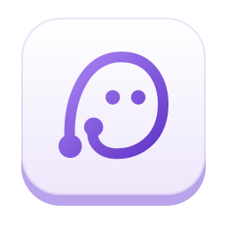

<p align="center">
  
</p>

<h1 align="center">Nyra Bot</h1>

<p align="center"><a href="README.md">English</a> · <b>Español</b></p>

Nyra Bot es una app de escritorio para hablar con modelos de IA. Funciona en macOS, Windows y Linux, con modelos que corren en tu equipo o en la nube. Puedes cambiar de modelo en mitad de una conversación sin perder el historial.

> Nyra está en una versión temprana (0.9.2).

## Descargar Nyra

Descarga el instalador de tu sistema en la [última versión publicada](https://github.com/snowandev/nyra_bot_desktop/releases/latest):

| Sistema | Archivo |
|---|---|
| macOS con Apple Silicon (M1 o posterior) | `Nyra.Bot_…_aarch64.dmg` |
| macOS con Intel | `Nyra.Bot_…_x64.dmg` |
| Windows | `Nyra.Bot_…_x64-setup.exe` |
| Linux | `.AppImage`, `.deb` o `.rpm` |

## Qué puede hacer

### Chat

- Respuestas en tiempo real. Puedes detenerlas, regenerarlas (cada versión se guarda), editar tus mensajes y abrir una rama desde cualquier punto.
- Adjunta imágenes, PDF, archivos de texto, hojas de cálculo, audio o un enlace.
- Tablas, bloques de código con formato, fórmulas y diagramas en las respuestas.
- Búsqueda en internet, con las fuentes citadas en la respuesta.
- Con los modelos que razonan, puedes ver lo que pensaron antes de responder.
- Cuando una conversación es tan larga que no cabe en el modelo, Nyra la resume sola y sigue.
- Comparte una respuesta como imagen, PDF o Markdown.

### Organización

- Carpetas en la barra lateral y conversaciones fijadas arriba.
- Conversaciones privadas, que no se guardan, y aisladas, que además no usan recuerdos ni skills.
- Búsqueda dentro de una conversación y en todas, también en el texto de los archivos adjuntos.
- **Recuerdos:** datos que le pides a Nyra que tenga presentes en otras conversaciones. Los ves y editas en Configuración.
- **Skills:** instrucciones reutilizables, por ejemplo para escribir con un estilo o seguir un proceso. El modelo las usa cuando hacen falta, o las eliges tú con `/`. Puedes crear las tuyas o importarlas.
- **Importar desde Claude Code:** tus sesiones, con sus archivos, entran en el proyecto de su carpeta.

### Trabajar con tus archivos

- **Conecta una carpeta** y el modelo podrá leer sus archivos y proponer cambios. Nada se escribe hasta que revisas cada cambio y lo aplicas, y lo que aplica Nyra se puede deshacer.
- **El espacio Código:** cada proyecto es una carpeta con sus conversaciones, los cambios pendientes, el estado de Git y los commits.
- **Comandos y código:** el modelo puede pedir ejecutar un comando o un script en la carpeta. Siempre lo ves antes y decides si se ejecuta.
- **Servidores MCP:** dale al modelo herramientas de otras apps. Cada uso te pide permiso, salvo las herramientas que marques como permitidas siempre.

### En tu escritorio

- **Chat rápido:** una barra que se abre con un atajo desde cualquier app, para preguntar algo sin cambiar de ventana.
- **Voz:** dicta tus mensajes o transcribe archivos de audio. Todo ocurre en tu equipo, con Whisper.
- **El navegador de Nyra:** el modelo puede abrir páginas, leerlas y usarlas en tu Chrome, Edge u otro navegador basado en Chromium, con tu permiso.
- **Tu pantalla:** Nyra puede mirarla para explicarte lo que ves, guiarte paso a paso señalando dónde hacer clic, o usar el ratón y el teclado si se lo permites.

### A tu gusto

- Tema claro, oscuro o el del sistema, color de acento y tamaño del texto.
- Interfaz en español e inglés. El modelo te responde en el idioma en que le escribas.
- Notificación cuando termina una respuesta y icono en la barra del sistema.

## Privacidad

- Con un modelo local, nada sale de tu equipo.
- Con un modelo en la nube, lo que envías va al proveedor que elegiste, con tu propia API Key. Nyra te avisa si un mensaje parece llevar datos sensibles.
- Las conversaciones, los recuerdos y los proyectos se guardan en tu equipo.
- Las conversaciones privadas y las aisladas no se guardan nunca.

## Diferencias entre sistemas

Nyra funciona igual en macOS, Windows y Linux, con estas excepciones:

| Función | macOS | Windows | Linux |
|---|---|---|---|
| Mirar la pantalla y guiarte | Sí | Sí | Todavía no |
| Usar el ratón y el teclado | Sí | Sí | Todavía no |
| Icono en la barra del sistema | Sí | Sí | Necesita `libayatana-appindicator`, y en GNOME la extensión AppIndicator |

En macOS, Nyra te pide los permisos de micrófono, grabación de pantalla y accesibilidad solo para las funciones que los usan.

## Compilar Nyra desde el código

Si prefieres compilarla tú, necesitas [Node.js](https://nodejs.org) 24 o posterior y [Rust](https://www.rust-lang.org/tools/install).

```bash
git clone https://github.com/snowandev/nyra_bot_desktop.git
cd nyra_bot_desktop
npm install
npm run tauri build
```

El instalador queda en `src-tauri/target/release/bundle/`. Si solo quieres probarla, `npm run tauri dev` la abre directamente.

## Licencia

Nyra se publica con la [licencia MIT](LICENSE). Puedes usarla gratis, también con fines comerciales, modificarla y crear tus propias versiones, siempre que mantengas el aviso de copyright y la licencia.
